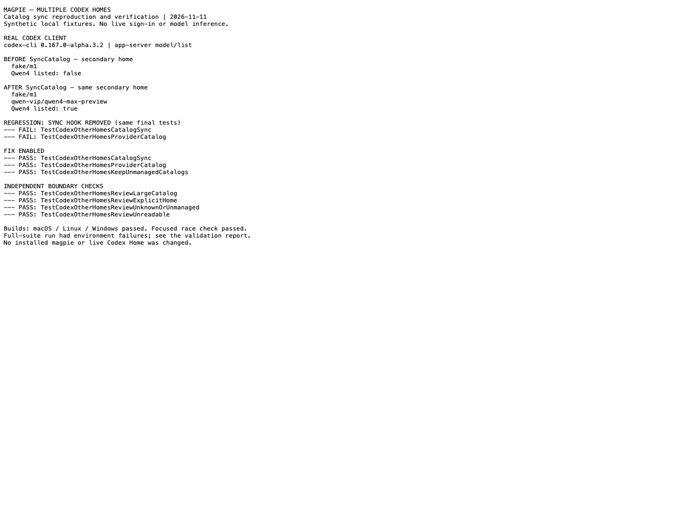

# Secondary Codex Home catalog sync: reproducible evidence

Code: [Harzva/magpie@86ef180a0dfa](https://github.com/Harzva/magpie/commit/86ef180a0dfad275a8a05a519e2e31c68cd7491c).
Base: `yetone/magpie@bc59aefd096c0d11ea0a8bdd9ac47349030ec718`. Date: 2026-11-11.

The screenshot is a diagnostic report, not an application UI screenshot.
It shows a **real Codex CLI app-server** reading synthetic local catalogs:
`fake/m1` before, then `fake/m1` and `qwen-vip/qwen4-max-preview` after the
patched `agent.SyncCatalog` refreshed a nested secondary home. Both client
processes exited 0. No live account, inference request, installation or
live-home write was used for this reproduction.

The source patch is [fix.patch](fix.patch) (`git am`), with no image or
generated evidence committed to the code branch. This separate evidence
branch contains only reviewed public fixtures and filtered test results.

## Final verification

Final code was rebased onto `bc59aefd096c0d11ea0a8bdd9ac47349030ec718` and independently read again.
Using Go 1.26.8 and macOS SDK 27:

| Check | Result |
| --- | --- |
| Catalog, desktop and home regressions | 34 top-level tests passed |
| `go vet ./...` | passed |
| `GOOS=linux go vet -tags nogui ./...` | passed |
| `GOOS=windows go vet ./...` | passed |
| Native, Linux nogui and Windows builds | passed |
| Focused `-race` home/catalog/link checks | passed |
| gofmt and diff whitespace | clean |

The final test set is in [catalog-tests.log](catalog-tests.log); independent
boundary checks are in [independent-tests.log](independent-tests.log).
With the secondary-sync hook removed, the final CatalogSync and
ProviderCatalog tests fail functionally ([expected-red.log](expected-red.log)).
The local client responses are [before](client-before.json) and
[after](client-after.json). These are catalog reads, not model executions.
Linux and Windows were cross-compiled and vetted, not run on those systems.
No GUI assets were changed; the browser GUI suite was not run.

## Full-suite limitation: not a green-suite submission

The full `go test -tags nogui -timeout 45m -p 4 ./...` run on initial base
`a3d2a85dd3803a3b8208d40fe5f61e8e63712e62`, with Go 1.27.2, failed. The
failed test names are retained in [results.json](results.json); raw logs
remain local because a few tests discovered host services despite HOME
isolation. No claim that every failure is a baseline or environmental
failure is made.

Confirmed and checked separately:

- Go 1.27 enables JSON v2 by default. The JSON encoding and Alma allocation
  tests pass with the repository's Go 1.26.8.
- Go 1.27 `t.TempDir` honors GOTMPDIR, bypassing Library's narrowed TMPDIR.
  The final runner omits GOTMPDIR; compilation and caches still use the
  external task volume.
- T7 has ownership disabled; a successful Chown did not establish the
  group-test precondition. Disclaimed children also met removable-volume
  TCC restrictions. The group, process, fake-daemon and representative
  Library child tests passed with tiny runtime fixtures on a short internal
  APFS path; see [micro-fixtures.log](micro-fixtures.log). This does not
  establish successful removable-volume/TCC behavior.

Remaining original-run failures were not all reclassified or rerun.
They include BTM service status, live-loopback fallback discovery, WSL
listener shutdown, proxy checking, handoff and Library imported-config
checks. CLI fallback tests were not rerun against the user's live gateway.
The full suite was not rerun after the rebase. A maintainer needs to run
the full acceptance suite in a suitable isolated environment before merge
or release. This submission is a bounded catalog fix for review.
